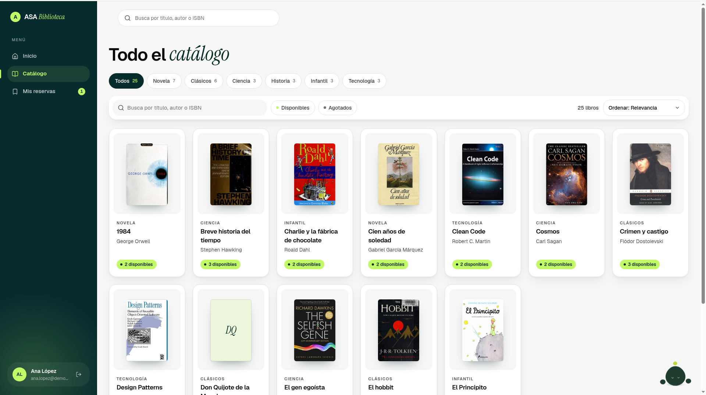
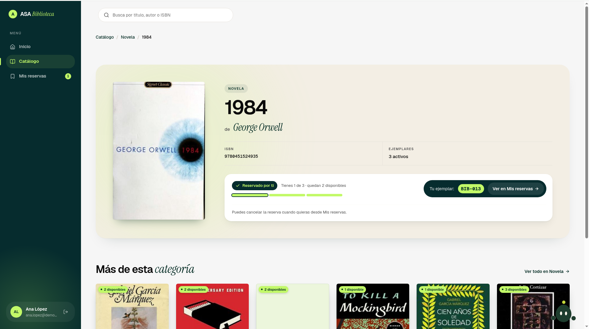

# frontend-asa

[](https://github.com/CristanPalma2203/frontend-asa/actions/workflows/ci.yml)

Aplicación web de la biblioteca ASA: los lectores buscan libros y los reservan, y el administrador gestiona el catálogo. El backend está en otro repositorio: [backend-asa](https://github.com/CristanPalma2203/backend-asa).

## Probar en vivo

- **App:** https://frontend-asa.cristianpalma1703.workers.dev
- **API:** https://ca-asa-backend-test.politerock-5d0ff971.centralus.azurecontainerapps.io

| Rol | Usuario | Contraseña | Qué puede hacer |
| --- | --- | --- | --- |
| Admin | `admin@demo.local` | `admin` | Gestionar libros, ejemplares y lectores, y ver el resumen. |
| Lector | `ana.lopez@demo.local` | `user` | Buscar en el catálogo, reservar un libro y ver o cancelar sus reservas. |

Sin iniciar sesión se puede navegar por el catálogo y ver las fichas; para reservar hay que entrar como lector.

| Catálogo | Ficha del libro |
| --- | --- |
|  |  |

| Mis reservas | Administración |
| --- | --- |
|  |  |

## Stack

- React 19, Vite y TypeScript
- Tailwind CSS 4 y shadcn/ui
- TanStack Router y TanStack Query
- React Hook Form + Zod
- Vitest + Testing Library (con MSW para simular la API)

## Arquitectura

El código se organiza por **feature** (`biblioteca`, `admin`, `auth`, `luxia`) y, dentro de cada una, por **tipo de pieza**:

- `components`: la interfaz;
- `services`: las llamadas a la API, separadas en lectura y escritura;
- `hooks`: las consultas y mutaciones de TanStack Query;
- `types`: el contrato de la API;
- `schemas`: la validación con Zod.

Las rutas son finas: definen la URL, los permisos y los parámetros, y montan la página de su feature.

```
src/
  routes/        URLs, permisos por rol y parámetros de búsqueda
  features/
    biblioteca/  catálogo, ficha y reservas (components, services, hooks, types, schemas)
    admin/       páginas de administración
    auth/        sesión y login
    luxia/       asistente de consulta
  components/    layout y componentes de interfaz compartidos
  lib/           cliente HTTP, fechas y animaciones
  test/          API simulada y utilidades de test
```

## Decisiones clave

- **Errores por código.**
  - El backend responde con ProblemDetails y un `code` estable (`sin-stock`, `reserva-duplicada`…). El front traduce ese código a un mensaje claro y no depende del texto del servidor.
  - Los errores de validación se muestran en el campo que corresponde.
- **Caché siempre al día.** Al reservar, cancelar o editar se invalidan el catálogo, la ficha y las reservas, así que la disponibilidad que ves es la real. La cancelación es optimista: si falla, se deshace.
- **Un solo «Reservar».** El lector no elige ejemplar: el backend asigna uno disponible y la app le muestra su código («Tu ejemplar: BIB-002»).
- **Rutas protegidas por rol.**
  - «Mis reservas» exige sesión de lector y `/admin` exige rol Admin.
  - Sin permiso, la app manda al login y después vuelve a donde estabas.
  - Un token vencido o un 401 cierran la sesión.
- **LuxIA, solo consultiva.**
  - El asistente responde preguntas sobre el catálogo («¿quedan ejemplares de Dune?»).
  - Funciona con reglas y consulta la misma API del catálogo. No usa un LLM ni necesita llaves.
  - No reserva: enlaza a la ficha del libro.
  - Su conversación se borra al cerrar sesión.
- **Huecos de carga solo en los datos.** Mientras llega la información, la pantalla ya está dibujada y solo parpadean los huecos de los datos (portadas, títulos, cifras), sin pantallas de carga completas.
- **Animaciones que respetan «reducir movimiento».** Si el sistema tiene esa opción activa, todo aparece al instante y sin desplazamientos.

## Pantallas

**Lector**

- Inicio con buscador, categorías y libros destacados.
- Catálogo con búsqueda, filtros, paginación y un panel lateral con el resumen de cada libro.
- Ficha del libro con su disponibilidad y el botón «Reservar».
- Mis reservas: ver las activas y el historial, y cancelar.
- LuxIA: chat de consulta sobre el catálogo.

**Admin**

- Resumen con las métricas de la biblioteca.
- Libros: alta, edición y desactivación.
- Ejemplares de cada libro: alta, edición del código, activar o inactivar y desactivar.
- Lectores: alta y edición, incluido marcarlos como activos o inactivos.

## Correrlo en local

Requiere **Node 22**. El backend corre aparte: ver el [README de backend-asa](https://github.com/CristanPalma2203/backend-asa#readme).

```bash
cp .env.example .env    # VITE_API_URL=http://localhost:8080 (URL del backend)
npm ci
npm run dev             # http://localhost:5173
```

Despliegue: ver [docs/DEPLOY.md](docs/DEPLOY.md).

## Tests

```bash
npm test
```

Cubren:

- **Catálogo:** búsqueda, filtros, paginación y estados vacío y de error.
- **Reservas:** reservar (código del ejemplar y disponibilidad actualizada), reserva duplicada, sin stock, y cancelación con vuelta atrás si falla.
- **Admin:** inactivar, editar y desactivar ejemplares, con conflictos de concurrencia y errores del backend.
- **Sesión:** login con credenciales inválidas y limpieza de LuxIA al cerrar sesión, con un 401 o con el token vencido.
- **LuxIA:** respuestas del catálogo, tarjetas de libro y foco del panel.
- **Fechas** en hora de El Salvador, **mensajes de error** por código y **animaciones** con «reducir movimiento».

En Windows, correrlos desde una ruta con la unidad en mayúscula (`C:\…`, no `c:\…`), o Vitest no arranca.

## Supuestos

- Las fechas llegan en UTC y se muestran en hora de El Salvador.
- La URL de la API se fija al compilar (`VITE_API_URL`).
- Editar y desactivar ejemplares usan `PUT` y `DELETE /api/ejemplares/{id}`; la edición envía el `rowVersion` para detectar cambios concurrentes.

## Con más tiempo haría

- Tests de punta a punta con Playwright contra el backend real.
- Una Content-Security-Policy estricta.
- Renovación del token sin volver a iniciar sesión.
- Pasar la animación del avatar de LuxIA a data binding de Rive.

## Autor

Alex Palma · [LinkedIn](https://www.linkedin.com/in/cristian-palma-07a407259) · [GitHub](https://github.com/CristanPalma2203)
