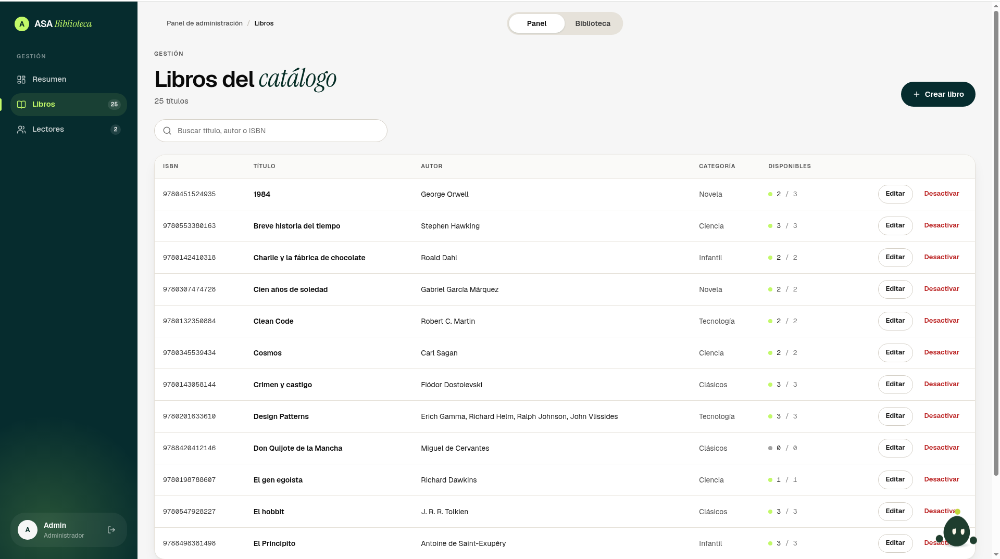

# frontend-asa

SPA de la biblioteca ASA. Los lectores buscan en el catálogo, ven la ficha de cada libro con sus ejemplares, reservan una copia y gestionan sus reservas. El administrador mantiene libros, ejemplares y lectores.

> **El backend es otro repo:** [backend-asa](https://github.com/CristanPalma2203/backend-asa) (.NET 10 + SQL Server). Este proyecto solo consume su API.

| Catálogo | Ficha del libro |
| --- | --- |
|  |  |

| Mis reservas | Administración |
| --- | --- |
|  |  |

## Stack

- React 19, TypeScript y Vite.
- TanStack Router (rutas por archivo, tipadas) y TanStack Query (estado del servidor).
- Zustand para la sesión, persistida en `localStorage`.
- React Hook Form + Zod para los formularios y la validación de search params.
- Tailwind CSS 4, componentes estilo shadcn/ui (Radix) y sonner para los avisos.
- TanStack Table para la vista de tabla del catálogo.
- Vitest, Testing Library y MSW para los tests.
- Docker: build con Node 22 y nginx para servir los estáticos.

## Estructura

Organizo el código por **features**. Cada una trae su API, tipos, hooks, schemas y páginas. Las rutas son delgadas: definen la URL, los guards y el `search`, y montan la página de la feature.

```
src/
  routes/              Rutas de TanStack Router (routeTree.gen.ts se genera solo)
    __root.tsx           Layout y título por ruta (el Toaster se monta en main.tsx)
    catalogo.tsx         /catalogo
    libros.$idLibro.tsx  /libros/:idLibro
    mis-reservas.tsx     /mis-reservas (requiere sesión de lector)
    login.tsx            /login?redirect=…
    admin/               /admin/libros, /admin/libros/:idLibro, /admin/lectores (rol Admin)
  features/
    auth/              store (Zustand), login y guards (requireSession / requireAdmin)
    biblioteca/        páginas del lector (catálogo, ficha, mis reservas), errores.ts y queryKeys.ts
      components/        UI del módulo: badges, portadas, tarjetas, tablas, formularios y diálogos
      services/          llamadas a la API separadas en *.read.ts y *.mutation.ts por recurso
      hooks/             useQuery/useMutation por recurso (use-libros, use-ejemplares, use-reservas…)
      types/             contrato de la API y uniones de estados
      schemas/           esquemas Zod de formularios y de search params
    admin/             páginas de administración de libros, ejemplares y lectores
  components/
    layout/            AppShell (público) y AdminShell
    ui/                botones, badges, inputs, diálogos…
  lib/
    api/client.ts      fetch tipado: token, ProblemDetails → ApiError
    fechas.ts          formateo UTC → America/El_Salvador
  config/env.ts        valida VITE_API_URL con Zod al arrancar
  test/                MSW (handlers, api-fake con estado, fixtures), sesión, setup y render con router
```

## Cómo correrlo

Primero levanto el backend, ya sea en Visual Studio (`https://localhost:44358`) o con `docker compose up` en el repo del backend (`http://localhost:8080`). El backend solo acepta CORS desde `http://localhost:5173`, así que el frontend tiene que servirse en ese origen.

### Con npm

Requiere Node 22.12 o superior (`engines` en `package.json`). `npm ci` funciona tanto con npm 10 (el que trae Node 22) como con npm 11.

`.npmrc` activa `legacy-peer-deps`. npm 10 y 11 resuelven distinto algunas peer dependencies opcionales y cada uno rechazaba el lockfile del otro. Con esta opción ambos validan el mismo árbol. A cambio, npm ya no instala peers automáticamente: las obligatorias van declaradas en `package.json` (por eso está `@testing-library/dom`).

```bash
cp .env.example .env    # ajusto VITE_API_URL según dónde corre la API
npm ci
npm run dev             # http://localhost:5173
```

### Con Docker

La URL de la API queda fija en el bundle al compilar, así que va como build arg:

```bash
docker build --build-arg VITE_API_URL=http://localhost:8080 -t frontend-asa .
docker run --rm -p 5173:80 --name frontend-asa frontend-asa
# http://localhost:5173
```

- La imagen es multi-stage: `node:22-alpine` compila con su npm 10 (`npm ci` con el mismo `.npmrc`) y `nginx:alpine` sirve `dist/`.
- `nginx.conf` hace fallback a `index.html` para que funcionen los deep links (`/libros/1`, `/admin/...`). Los assets con hash se cachean como `immutable` y `index.html` va con `no-cache`.
- Todas las respuestas, también las de error, llevan `X-Content-Type-Options: nosniff`, `X-Frame-Options: DENY` y `Referrer-Policy: strict-origin-when-cross-origin`.
- Si falta `VITE_API_URL`, el build falla con un mensaje claro.

Si `npm run dev` ya ocupa el 5173, hay que pararlo antes de `docker run`. Si no, el navegador seguirá llegando a Vite.

## Despliegue (Cloudflare con wrangler)

**En vivo:** _URL pendiente: pon aquí la que devuelve `wrangler deploy`._

`wrangler.jsonc` publica `dist/` como assets estáticos de un Worker, con `not_found_handling: "single-page-application"` para que los deep links (`/libros/1`, `/admin/...`) caigan en `index.html`.

```bash
npm run build           # con VITE_API_URL apuntando a la API pública
npx wrangler deploy
```

`public/_headers` se copia a `dist/` y añade a todas las respuestas `X-Frame-Options: DENY`, `X-Content-Type-Options: nosniff`, `Referrer-Policy: strict-origin-when-cross-origin` y una `Permissions-Policy` que apaga cámara, micrófono, geolocalización, pagos y USB.

## Variables de entorno

| Variable | Obligatoria | Ejemplo |
| --- | --- | --- |
| `VITE_API_URL` | Sí | `http://localhost:8080` (backend en Docker, el valor de `.env.example`) o `https://localhost:44358` (IIS Express) |

Está en `.env.example`. `src/config/env.ts` la valida con Zod y, si falta o no es una URL, la app falla al arrancar con un mensaje explícito.

## Scripts

| Script | Qué hace |
| --- | --- |
| `npm run dev` | Servidor de desarrollo de Vite |
| `npm run build` | `tsc -b` + build de producción en `dist/` |
| `npm run preview` | Sirve `dist/` localmente |
| `npm run typecheck` | Chequeo de tipos sin emitir |
| `npm run lint` | ESLint |
| `npm test` | Vitest en modo run |
| `npm run format` | Prettier |

## Tests

```bash
npm test
```

Uso Vitest con jsdom, Testing Library y **MSW**, que intercepta `fetch` con handlers tipados contra el contrato de la API. `src/test/handlers.ts` trae respuestas fijas. `src/test/api-fake.ts` es una API en memoria con estado: calcula "disponibles" desde los ejemplares, igual que el backend, así que reservar o inactivar cambia lo que devuelven los GET siguientes.

Los tests de invalidación usan el `staleTime` de la app (30 s). Así, un dato solo se vuelve a pedir si una mutación lo invalidó. Cubren:

- **Catálogo:**
  - listado, estado vacío y error;
  - búsqueda: envía `?search=` y muestra solo lo filtrado;
  - filtro de autor: envía `?autor=`;
  - paginación: `?page=2`.
- **Ficha:**
  - reservar sin sesión manda a login;
  - reservar muestra "Tu ejemplar: <código>" y la disponibilidad baja de 3 a 2 en la ficha y en el catálogo;
  - `reserva-duplicada`;
  - sin stock (409): se cierra el diálogo, queda el mensaje y no cambia nada.
- **Admin:**
  - inactivar un ejemplar baja los disponibles del libro en el detalle y en la lista;
  - editar un ejemplar (`PUT /api/ejemplares/{id}` con `rowVersion`): validación Zod, código duplicado en el campo y conflicto de concurrencia;
  - desactivar un ejemplar (`DELETE /api/ejemplares/{id}`): pide confirmación, invalida libros y ejemplares y muestra el `code` del ProblemDetails si falla.
- **LuxIA:** apertura y cierre con foco, respuestas desde `/api/libros`, historial limitado y borrado al cerrar sesión.
- **Movimiento:** con movimiento reducido todo queda visible al instante, `CountUp` llega al valor final y al desmontar no quedan tweens vivos.
- **Mis reservas:**
  - cancelación con *update optimista* y rollback si el servidor falla;
  - fecha mostrada en hora de El Salvador.
- **Login:** credenciales inválidas.
- **Services:** el estado del ejemplar y el filtro de reservas van como texto.
- **Mensajes de error por `code`.**
- **Schema del lector:** contraseña opcional, mínimo 8.
- **Formateo de fechas.**

### Tests en Windows

Lanza los comandos desde la ruta con la unidad en **mayúscula**:

```powershell
cd C:\Users\<usuario>\Desktop\frontend-asa
npm test
```

Si la terminal está en `c:\…` (minúscula, lo habitual en la terminal integrada de VS Code), Vitest carga dos veces el mismo módulo y todos los archivos fallan con "failed to find the runner". No es un fallo de los tests. El timeout por test es de 15 s (`vite.config.ts`) para que los tests de integración no fallen en máquinas lentas.

## Decisiones

**TanStack Router.**

- Rutas por archivo con tipos de punta a punta: params, `search` validado con Zod y links tipados.
- Los guards van en `beforeLoad` (`requireSession`, `requireAdmin`) y redirigen a `/login?redirect=…`. Tras el login vuelvo a la ruta original.
- El título de cada página sale de `staticData.title`.

**TanStack Query.**

- Es todo el estado del servidor, con claves centralizadas en `queryKeys.ts`, `staleTime` de 30 s y sin reintentos en errores 4xx.
- Después de reservar o cancelar invalido catálogo, ficha y mis reservas.
- La cancelación es optimista: la reserva desaparece al instante y, si la API falla, restauro el snapshot.

**Zustand.**

- Guarda solo la sesión (token, expiración, rol, nombre, `lectorId`), persistida en `localStorage`.
- El cliente HTTP la lee fuera de React.
- Un token vencido no se envía.
- Un 401 cierra la sesión y lleva al login.

**Errores por `code`.**

- El backend responde ProblemDetails con un `code` estable (`sin-stock`, `reserva-duplicada`, `conflicto-concurrencia`…).
- `client.ts` lo convierte en `ApiError` y `errores.ts` lo traduce a un mensaje para el usuario. Nunca dependo del texto del servidor.
- Los `errors` por campo de `validacion-fallida` se pintan en el input que corresponde.
- Un `conflicto-concurrencia` al cambiar un ejemplar recarga la lista con el `rowVersion` nuevo.

**Fechas: UTC → El Salvador.**

- La API devuelve todo en UTC con `Z`. `formatearFecha` lo muestra con `Intl.DateTimeFormat('es-SV', { timeZone: 'America/El_Salvador' })`, sin depender de la zona del navegador.
- Si llegara un ISO sin zona, lo trato como UTC.

**LuxIA (asistente consultivo).**

- Responde preguntas sobre el catálogo («¿hay ejemplares de Dune?», «libros de García Márquez») con **reglas**: interpreta la pregunta y consulta `GET /api/libros`. No usa ningún LLM, no necesita llaves ni endpoints nuevos y **no reserva**: enlaza a la ficha del libro.
- Solo aparece en las pantallas con sidebar (no en la Home, el login, el 404 ni la pantalla de error).
- El avatar es una animación Rive cargada bajo demanda; el runtime `.wasm` se sirve desde `/luxia/`, sin CDN. Con movimiento reducido o sin canvas se usa una imagen estática.
- El historial se guarda en `localStorage` (`asa-luxia-history`, últimos 10 mensajes) y se borra al cerrar sesión.

**Animaciones con GSAP.**

- `src/lib/motion.ts` reúne las entradas (`reveal`, `cardsIn`, `titleLines`, `pop`), los diálogos y los efectos de puntero (`lift`, `magnetic`). `useMotion` las ata a un contenedor con `useGSAP`, así todo se revierte al desmontar.
- Con `prefers-reduced-motion` todas las duraciones valen 0 y el contenido queda visible al instante.

**Placeholders con boneyard.**

- Mientras llegan los datos, cada hueco (portada, título, cifra, fila de tabla) muestra un hueso con shimmer y el resto de la pantalla ya está pintado: no hay pantallas de carga completas.
- `Hueso` y `PortadaConCarga` (`components/ui/hueso.tsx`) envuelven el `<Skeleton>` de boneyard. Sobre fondos oscuros se usan colores lima translúcidos.
- Con movimiento reducido el shimmer se detiene.

**Contrato tipado.** Los estados son uniones de texto (`'Activa' | 'Cancelada' | …`) que coinciden con lo que serializa el backend. Las etiquetas y colores de cada badge salen de `estados.ts`.

## Autor

Alex Palma. [GitHub](https://github.com/CristanPalma2203).
